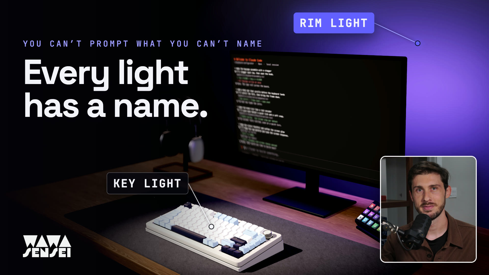

<a href="https://youtu.be/aVo3M2IEw9o"></a>

▶️ **Watch the video:** [You can't prompt what you can't name](https://youtu.be/aVo3M2IEw9o) · **Live demo:** [keyboard.wawasensei.dev](https://keyboard.wawasensei.dev)

# Keyboard — color study

A procedural 75% keyboard on a 160 × 75 cm electric standing desk. React,
TypeScript, Vite, Three.js, React Three Fiber, Drei, Zustand and GSAP.

## Run

```sh
npm install
npm run dev
```

Drag to orbit; scroll or pinch to zoom. Choose a swatch to disassemble, recolor,
and reassemble. The picker supports Tab, arrows, Home and End. Reduced-motion
preferences remove the stagger and shorten the assembly.

```sh
npm run build
npx playwright install chromium  # first time on a new machine
npm run shots
npm run perf                   # optional native GPU timing, preview on port 4176
```

`shots` serves **the existing production build** with Vite preview on port 4175,
launches headless Chromium with Metal on macOS (SwiftShader elsewhere), and closes both processes after
capture. Set `SHOTS_RENDERER=swiftshader` to force software WebGL. Rebuild after source changes. The bundled local CC0 assets mean no
remote asset requests are needed at runtime. `npm run assets` downloads them again.

`?debug` → **Camera → Lens** edits the live perspective camera: linked focal
length (12–200 mm) and vertical FOV, film gauge, and near/far clipping. Sensor
edits retain focal length. Desktop defaults use **80.343 mm**, 35 mm film gauge
and 0.008–25 m clipping. Three derives vertical FOV from aspect: **15.5046° at
16:10**; the copied **19.022°** corresponds to approximately 1.30:1. Untouched
lens defaults retain 80.343 mm across desktop resizing; edited lenses retain the
chosen vertical FOV. The hero position is `(0.153890, 1.375464, 1.229136)`, target
`(0, 0.825, 0.005)`, with orbit limits **0.317–1.351 m**. Copied coordinates place
it 0.000000257 m over the maximum; a one-micrometer boundary tolerance preserves
that exact pose without changing the displayed/stored bounds. Reset restores it.
Portrait retains its previous **32° FOV and 0.317–0.719 m bounds**, composition,
and existing right-side keyboard crop; it has not been reframed.
**Copy camera values** includes all fourteen lens parameters; **Reset camera** restores
the lens, pose and orbit bounds. Depth of field and autofocus default on, with
bokeh scale 1 and **auto focal range** (minimum **0.38 m**, margin **0.025 m** per side).
Focus and range use the eight world-bounds corners projected into camera depth,
with approximately 120 ms critically damped settling. The distance-scaling amount
is **0.65**; it gently reduces blur at close distances. Manual focus/range remain
available, and Copy/Reset includes every optical setting.
**Focus on keyboard** uses the same view-depth center. The full-resolution DoF
uses a balanced disk gather with neighbor-depth rejection: far blur cannot paint
focused caps, while near blur can softly overlap the background. Color and native
depth use identical texel coordinates. One MSAA scene render supplies both DoF
and dust; later fullscreen buffers are single-sample. Sparse HDR bloom blurs at
quarter resolution with its physical Gaussian footprint preserved. The threshold
seed stays at the original half resolution so tiny LCD/chrome sources survive.
Pixel-delta checks bound the small differences around highlights. Resources are disposed with
the composer; the shared fullscreen triangle remains a library cache.
`npm run shots` also checks lens conversion, sensor/FOV linking, copy/reset,
portrait resizing and DoF pixels/disposal; captures `lens-85mm.png` (same pose)
and `lens-dof.png`. Spec-10 captures add `dof-close/default/far.png` plus two
orbits, cap-edge contrast against DoF off, and a known-depth silhouette regression
(with a one-pixel bleed limit). Five pixel comparisons test the exact LTC early
zero guard and scene-only MSAA against the unoptimized reference switches.

Ordinary viewing adapts DPR in 0.125 steps within 1–2, with two slow windows to
step down, four fast windows to step up, and a five-second cooldown. Capture/perf
URLs pin DPR so adaptation cannot hide regressions. Debug readouts update only
with `?debug`. Leva registration remains eager: its
shared store is used by scene/material initialization, and its global-root hook
auto-mounts the panel if its explicit hidden owner is removed.
`npm run perf` also runs `scripts/perf-profile.mjs`: GPU A/B timings with local
before/after anchors, main-thread TaskDuration, draw/triangle/program counts,
identified texture/attachment byte estimates, cold startup and bundle tables,
and 4× CPU plus DPR-2 pixel-load stress. GPU-clock throttling is unavailable in
CDP; raw results and machine load are recorded in `screenshots/perf-profile-*.json`.

## Architecture

- `src/keyboard/layout.ts`: explicit key positions, dimensions, legends and default
  color groups, in 19.05 mm units. All scene dimensions are meters.
- `src/keyboard/variants.ts`: seven palettes, body/frame colors, knob finishes and
  per-key group overrides. Future per-key customization can extend this resolver.
- `src/keyboard/geometry/`: cached, width/row-specific keycap shells with rounded,
  tapered sides and a subdivided rectangular cylindrical dish grid with analytic
  smooth normals and six rounded edge strips. Stronger per-row height/tilt sculpt;
  rounded wedge, recessed frame, plate and horizontal case groove builders. The
  case front is approximately 22 mm high, rising to about 40 mm at the back, with
  approximately 3.2 mm clearance between the cap skirts and the well walls.
- `src/keyboard/legends.ts`: one lazily created 2048² transparent white glyph atlas;
  fixed physical text scale, curved legend surfaces and shared tint materials.
- `src/keyboard/materials.ts`: persistent PBR materials shared by color group.
- `src/keyboard/{Keyboard,Case,Keycap,Switches,Knob}.tsx`: assembly composition,
  instanced MX-style switches (dark bases, sloping milky top housings with stem
  openings and side latches, amber cross stems), stabilizer hints, fluted knob and chrome.
- `src/keyboard/assembly.ts`: GSAP lift/recolor/insertion timelines. A new selection
  kills the previous timeline and retargets from current transforms and colors;
  only the final timeline can finish. Initial assembly is about 2.15 seconds.
- `src/state/store.ts`: requested/displayed variant and animation phase. It separates
  selection from the palette currently being rendered during a transition.
- `src/scene/`: physically sized desk, rounded three-stage columns, tapered T-feet
  and levelers, rails/brackets, motor/control enclosure and front-right handset.
  Muted satin oak with real-world grain and mapped eased edges. The desktop
  holds exactly the keyboard, monitor, felt mat, 15-key control pad and headphones
  on their walnut stand. `PracticalFixtures.tsx` builds the 27-inch
  monitor, its off-panel reflections, and smooth generated wallpaper. Its owned rounded-box
  neck avoids extruded-edge raster fragments through the wallpaper in software
  WebGL; a projected pixel check guards against their return.
  `StudioWall.tsx` places a real charcoal satin-painted wall 30 cm behind the desk. It uses generated,
  non-repeating 512² roller/orange-peel normal and roughness fields; the
  plaster scans are removed. Paint defaults are **#2a2b2e**, roughness **0.55**,
  normal strength **0.035**. An explicit environment response of 3.5 keeps
  charcoal visible in the dim studio while the physical softbox and rear
  monitor glow supply the falloff and sheen. The background is
  black, without fog. A dark floor grounds the desk in wide views.
  The Wall folder's light mask defaults on, with elliptical radii **1.6 × 0.8 m**
  and feather **0.35** (fraction of radius). It follows the monitor's projected
  wall-glow position, including gizmo yaw. `onBeforeCompile` multiplies the
  complete outgoing linear radiance just before output: direct light, IBL,
  specular and emission all fall to black outside the ellipse. The interior
  remains unchanged, retaining the purple halo and paint response. Its support
  ends above the physical wall bottom, hiding the edge from any viewing angle.
  Copy lighting values includes `wall.mask`; `wall-mask-right.png` and the
  halo/on-off pixel checks cover the rightmost, low-elevation orbit.
  `Lighting.tsx` saves the user-tuned rig: **44 × 68 cm**
  softbox at **(-0.67, 1.75, 0.80)** m, aimed at **(0, 0.79, -0.02)**,
  intensity **0.75**, **#fff7f0**; linked spot **6.235**, angle **0.21 rad**,
  penumbra **0.78**, softness **147**, radius **4.1**. The right **1.8 × 1.5 m**
  fill is **0.25**, **#eee4ff**, at **(1.4, 1.4, 0.4)**, with the same aim.
  Monitor **Screen on** defaults true; rim **7.1**, rear wall glow **27.2**, both
  **#8f77ff**. Exposure is **1**. RectAreaLight LTC uniforms are initialized once;
  the 2048px spot map is cached while assembled and uses 24-sample PCSS edges.
  `RigEnvironment.tsx` uses **lightformerIntensity 1.28**, **hdriIntensity 0.095**,
  **HDRI rotation −1.29 rad**. Cards match the real source positions, sizes,
  plane orientations and radiance. The probe is at the keyboard; the HDRI rotates
  independently. Stable memoized portal children and **frames={1}** at 256²
  capture only when a reflection-affecting setting changes, never for assembly,
  orbit or idle frames. The main background remains black.
  The monitor's screen card is independent of its purple rear bias light and
  uses the display's measured mean in linear light. Caps retain their palette
  hexes with the earlier satin plastic finish and environment response **3.6**.
  The purple practical is allowed to tint them naturally; color fidelity is
  checked separately under the isolated key with neutral studio reflections. Turning
  Screen on off restores near-black coated glass and a dim planar reflection of
  the actual desk and keyboard. That pass is cached while stationary and limited
  to 30 Hz during assembly. All of its allocated resources are owned/disposed.
  `Desk.tsx` uses MeshPhysicalMaterial for satin-lacquered oak. The **Desk** Leva
  folder defaults to **normal strength 0.45**, **coat normal strength 0.18**,
  **clearcoat 0.24**, **coat roughness 0.22**, **coat roughness map influence 0.32**,
  base grain roughness **0.30 + 0.32 × map**, and **envMapIntensity 0.9**.
  Both layers share the veneer normal and roughness textures, with the lacquer's
  weaker normal response representing partly filled pores. Coat roughness is
  `clamp(0.22 + 0.32 × (map − 0.5), 0.0525, 1)`; zero influence makes it uniform.
  Every value is live and included in **Copy lighting values**. Uniform changes
  do not rebuild geometry or recapture the environment.
  The former 0.055 base normal was too weak, the coat had neither map, and an
  analytic panel replacement suppressed standard coat IBL to 8%. The result
  could not show convincing grain in the lacquer reflections. That replacement,
  its panel uniforms, and its duplicate layout-follow wiring have been removed.
  Both layers now use Three's standard per-pixel normal/roughness-dependent IBL
  and direct specular, with full coat IBL from the shared rig environment.
  The base's lower roughness adds soft grain-modulated specular even uncoated.
  The material explicitly binds the existing environment so its own intensity
  works. It retains the warm base texture, 88% chroma and existing eased-edge UVs.
  The keyboard-centered cubemap remains an approximation for nearby parallax;
  it is shared and captured only when reflection-source controls/layout change.
  No reflection-specific rectangles, extra render passes, or textures are added.
  The wall reflection card represents diffuse paint return (0.035 gain),
  following the saved 27.2 / #8f77ff bias light and gating with screenOn.
  The LCD uses 0.62 radiance and a subdued continuous mint/lavender gradient;
  its environment card uses the same radiance and linear average color. The front-left softbox
  catches the eased front edge; the rear screen is seen in the horizontal top
  at grazing angles. The felt masks the central reflection, as a real mat would.
  `props/DeskMat.tsx` builds a **90 × 40 cm**, **4 mm** felt pad with 14 mm plan
  corners and a compressed 0.6 mm edge. ambientCG Fabric 034 supplies 2K color,
  normal and roughness at 22 cm tile scale, tinted heathered charcoal with sheen
  and very low dielectric shine. Edge UVs use thickness rather than stretching
  the top texture vertically. Keyboard feet are seated on the measured mat top:
  `KEYBOARD_Y` accounts for the case tilt and half the rubber-foot thickness.
  Root placement carries every assembly target, switch, cap and shadow upward.
  `props/StreamDeck.tsx` builds a 118 × 84 × 21 mm black control pad on an open
  wedge stand. Fifteen clear rounded key tops protrude **3 mm** above the faceplate,
  with **0.3 mm** opening gaps; LCD faces sit **0.6 mm** below the tops.
  Tops and bezels are instanced, LCDs share one merged generic icon atlas.
  A dark icon on the white key preserves contrast. **Stream Deck** controls
  default to emission **2.4**, bloom strength **0.16**, threshold **2.0**,
  and spill intensity **0.8**. One **10 × 1.8 cm** RectAreaLight, colored from
  the atlas's measured linear average, aims down across the plate and nearby support surface.
  The area source avoids a point-like specular pinprick on wood. It follows the deck
  and is disabled in all isolated-light captures. No logos or wordmarks.
  `StudioPost.tsx` uses Three's WebGL HDR EffectComposer: scene → bloom → DoF
  → occluded dust overlay → grading/tone mapping/sRGB.
  The high luminance threshold blooms bright LCD content while leaving the
  monitor gradient and ordinary paint/caps alone. The chosen tone mapping/exposure
  run once at output. MSAA preserves edges; all per-mount targets and materials
  are released on unmount (including the bloom library's high-pass material).
  `props/Headphones.tsx` builds smooth superellipsoid aluminum cups, rounded knit
  cushions and baffles, solid normal/roughness-mapped knit canopy with sheen,
  thin stainless headband rails and straight polished telescoping stems. Both
  vertical cups face inward symmetrically, with top-center hinges. Space-grey
  anodized aluminum uses #5d5f63, metalness 0.9 and roughness 0.34; crown/button
  sit atop the right cup. Its rounded walnut tray and curved headrest
  reuse the desk's wood family with a darker finish. Props stay static during
  keyboard assembly, cast/receive shadows, share geometry/materials, and explicitly
  dispose owned geometry, materials and cloned/generated textures. Shared loader
  textures and the environment remain separate owners.
  `PropLayout.tsx` and `state/layout.ts` provide constrained **Layout** controls
  below Camera: X/Z position and Y rotation in degrees for the headphone stand,
  monitor and Stream Deck. **Show gizmos** is off by default and only renders
  drei PivotControls in `?debug`. The handles have X/Z arrows, an XZ plane and a
  Y arc; no height, scaling or other rotation handles. Orbit pauses for the entire
  real pointer drag. Numeric fields and handles share one store. Rotated footprints
  clamp to the desk; the deck sits on the highest surface its support touches,
  following the felt's 4 mm height as it moves on/off it.
  **Copy layout values** exports `{ headphones, monitor, streamdeck }`, each with
  `{ x, y, z, rotationY }`. Default X/Z/Y-rotation values are headphones
  `(-0.5380, -0.3517, 0.0°)`, monitor `(0, -0.3840, 0.0°)`, and Stream Deck
  `(0.2810, -0.3350, -24.6°)`; all three resolve to wood height **0.75 m**.
  The copied headphone angle −0.019° rounds to 0.0°. Position fields preserve four
  decimals and rotation fields show degrees to one decimal. The Stream Deck is
  fully behind the mat at startup; moving onto felt still raises it to 0.754 m.
  Monitor geometry and the saved light rig retain their original calibration
  frame, transformed by Layout from first mount. Moving the
  monitor carries its complete stand, screen, rim/bias lights and reflection card.
  The rear glow projects back onto the wall. Wood follows the same cached rig
  environment through standard IBL, with no separate desk-coat transform wiring.
  Cubemaps stay frozen during a pointer drag and refresh once on release;
  numeric/debug-store edits refresh once, with no idle captures. Prop moves also
  invalidate the spot's cached shadows.
  Below Layout, Leva groups **Key · softbox**, **Key · spot (shadows)**,
  **Fill · area**, **Monitor · rim**, **Desk**, **Environment**, **Stream Deck**, **Wall**, **Dust**, and **Film**.
  Copy lighting values exports
  `{ lights: { softbox, spot, fill, monitor }, desk, environment, streamDeck, wall, rendering, dust, film }`.
  The spot follows the softbox by default and can be unlinked.
  `?solo=key|softbox|spot|fill|rim|env` isolates each role. Key includes both key
  emitters; rim shows the saved purple screen rim (7.1) and wall glow (27.2), both #8f77ff.
  Env has four reflection cards plus dim HDRI. Other solos keep 0.008 HDRI
  and no Lightformers. Palette fidelity uses an ungraded Neutral reference capture;
  the hero uses the saved ACES Filmic grade.
  `CameraRig.tsx` puts **Camera first** in the `?debug` panel. It shows distance
  in meters (3 decimals) and polar/azimuth angles, refreshed at 10 Hz only in
  debug mode. `minDistance` / `maxDistance` sliders cover 0.10–6.00 m and apply
  live. **Set min = current**, **Set max = current**, **Copy camera values**, and
  **Reset camera** support exploration. Copy writes clipboard JSON with
  `{ minDistance, maxDistance, distance, polarDeg, azimuthDeg, position, target, lens }`.
  Reset restores the copied desktop hero and **0.317 / 1.351 m** bounds, with a
  one-micrometer tolerance for rounded coordinates. Portrait keeps **0.317 /
  0.719 m** and the previous lens/framing. Capture presets obey the active bounds.
  `dimensions.ts` places the keyboard center 19 cm behind the front edge.
- `src/ui/VariantPicker.tsx`: accessible radio-group picker with roving focus.
- `src/debug.ts`: typed capture/inspection interface for deterministic evidence.
- `scripts/screenshots.mjs`: production screenshots and meaningful assertions for
  partial assembly, every final transform, palette, repeated interruption, real-time
  animation, keyboard selection, reduced motion, mobile overflow and browser errors.
  Also checks the projected hero width (about 61% at 16:10), exact copied pose/reset, visible desk front edge,
  and records portrait crop honestly under the user's 0.719 m maximum. Mobile
  tests still enforce reduced motion, seated assembly, no DOM overflow, and the
  exact camera bounds. Studio checks assert entire softbox/fill bounds outside
  the hero frustum, the sole shadow caster, cached shadows, all six solo modes,
  live linking/unlinking, full default/edited lighting clipboard JSON, camera
  limits/current-distance buttons, camera clipboard/reset, and
  exact tuned defaults, screen-off and screen-on paths, wallpaper continuity,
  matching actual reflection-card transforms/radiance, debug-store movement,
  idle cubemap/planar caching, and owned wallpaper/reflection/cubemap/paint/floor
  resource disposal on two unmounts. The shared HDRI loader cache remains separate.
  `scripts/color-fidelity.mjs` samples 3×3 median patches from blank top-face
  points on H, Caps Lock and Enter in the
  Glacial Blue, Cool Black and Pink PNGs. Both the user's ACES + grade hero and the isolated-key Neutral
  reference comparisons are reported. The user's strong purple rim shifts dark caps, so
  the fidelity gate uses Neutral with grading off and the key softbox/spot with
  neutral studio reflections;
  the other direct lights are disabled only in that diagnostic context. Checks
  enforce approximately **5°** hue error (5.5° allowance for 8-bit dark-patch
  quantization) for chromatic targets (HSV saturation ≥12%), saturation error ≤12 percentage
  points for every sample, and rendered white saturation ≤5%. Near-neutral hue
  deltas are recorded but not gated because their hue is unstable at low chroma.
- `scripts/performance.mjs`: separate native-GPU production timing while assembled
  and during a colorway change; records the renderer and measured frame times.

## Dust motes

`scene/DustMotes.tsx` and `scene/dustShader.ts` draw a few dust motes in the key
beam with one `Points` draw call. The motes are seeded once, with no per-frame
CPU loop. The vertex shader computes slow drift, slight upward convection and a
Brownian-like wander from time and a per-mote seed. Each mote wraps inside an
oriented box around the cone, from mid-beam to the aim point. The box faces fade
out, so wrapping never pops. Brightness uses the **live** `studio-key` spot:
three's cone/penumbra smoothstep (cubed, so dust gathers in the core) and
distance falloff, with a mild forward-scatter phase and a per-mote twinkle. Motes
outside the cone are exactly zero and emit no fragments. Sprites are soft radial
falloffs tinted by the key color, with additive blending, `depthWrite: false` and
occlusion against the shared native scene depth texture, including when DoF
is off. A separate layer renders after DoF with one Points draw. Size
follows distance and a gentle circle-of-confusion enlargement relative to the
keyboard focus point; the shader preserves energy as it softens. Sprites clamp
to 0.7–8 CSS pixels. No extra depth render or fullscreen dust pass is needed.

Before tuning, 44/120 motes were inside the cone, but the old default brightness
and 0.08× bloom luminance ceiling made even maximum intensity plateau. DoF
further scattered their few pixels. The default now caps at 0.45× bloom;
intensity can reach 12 and the cap rises smoothly to 2× bloom only at the high
end, keeping maximum intensity clearly visible. Defaults: **84 motes, 0.71 mm,
intensity 0.17, speed 1.85, padding 0.07 m**. A few faint dots survive default DoF;
max intensity is distinctly stronger. Reduced motion slows drift 5×;
`?capture` freezes it. Dust never intercepts pointer raycasts, casts shadows,
or enters depth-override/environment passes. Copy lighting values includes it.
Checks cover DoF-on pixel deltas, real cone containment/occlusion, one extra
draw, live controls, caching, reduced motion and disposal.

## Film controls (spec 09)

`?debug` → **Film** exposes six tone operators, exposure, contrast, saturation,
vibrance, temperature/tint, per-channel lift/gamma/gain and vignette amount/softness.
Copy lighting values includes the complete `film` section. The saved defaults are
**ACES Filmic, exposure 1**, grading enabled, contrast **1.11**, saturation **1**,
vibrance **0.19**, temperature **0.28**, tint **0.22**, lift **[0,0,0]**,
gamma/gain **[1,1,1]**, vignette amount **0.52**, softness **0.48**.
The scene renderer stays NoToneMapping; one final raw shader performs grading →
tone mapping → vignette → sRGB. An explicit **Neutral, grade off** reference
capture matches Three's original single OutputPass pixel-for-pixel. The user's
ACES/grade hue deltas are reported without gating those intentional color changes.

Bloom's **2.0** threshold uses scene-linear luminance before tone mapping and
exposure. A 5,040-point cap-top audit keeps the diffuse white caps below it:
caps seed zero bloom while actual Stream Deck LCD samples stay positive. The
ungraded reference also checks white clipping, shading and legend contrast.
Readbacks run only on an explicit capture request and add no ordinary-frame
GPU work. All per-mount targets/materials are disposed by their owner; Three's
shared fullscreen triangle remains cached. `scripts/film-checks.mjs` checks the
single tone mapper, Neutral reference, ACES/AgX and grade pixel deltas, default
DoF-on dust visibility, and actual headphone/bar geometry clearance.
`scripts/highlight-checks.mjs` audits HDR/bloom buffers and threshold invariance,
and gates fidelity only in dedicated Neutral captures with grading disabled.

`npm run perf` measures all effects with non-identity grading at native Metal
speed, then records asynchronous whole-frame GPU timer queries with each effect
disabled in turn. This avoids ANGLE/Metal assigning the entire command-buffer
duration to every pass. Per-pass CPU submission times are also recorded;
queries are disabled during normal viewing and FPS sampling.
The report records 1/5/15-minute machine load averages before and after the run.
Whole-frame GPU A/B deltas can be noisy under shared machine load; a negative
delta means the cost is within measurement noise, not a negative rendering cost.

## Interaction, typing and sound (spec 07c)

- **Keys:** hovering a seated keycap sinks it 0.7 mm (only when `phase === 'assembled'`);
  pointer down presses it to 3.6 mm full travel, stem included, and types its legend
  (clicked Shift is a one-shot latch, clicked Caps Lock toggles). Physical keys press
  the 3D key at the same *position* (`KeyboardEvent.code` → layout id,
  `src/keyboard/keymap.ts`) and type `event.key`, so non-US layouts type correctly.
  Auto-repeat types but never re-triggers the press. Keys are ignored while focus
  is in an input or the Leva panel; a focused button/radio keeps Space, Enter,
  arrows and Tab. Tab on the page indents; press Escape, then Tab, to reach the UI.
- **Seam:** `src/keyboard/KeyInteraction.tsx` is an additive layer. `assembly.ts`
  still owns each cap group and the knob group; interaction only offsets the cap
  group's children, the instanced stems, and the knob's inner `knob-spin` group.
  Springs run in `useFrame` over the few active keys; no React renders per key.
  Hit testing is one raycast per pointer move (keyboard bounding-box pre-check,
  then the cap meshes and knob). A capture-phase `pointerdown` on the Canvas
  wrapper stops presses on keys/knob reaching OrbitControls.
- **Monitor text:** `src/screen/ScreenText.tsx` is a CanvasTexture
  overlay on the powered screen at 0.85 radiance, outside the
  environment portal, so keystrokes never recapture reflections. The page is
  one bottom-anchored scrollback directly above the input, because the hero camera
  sees only the lowest ~40 mm of the panel. `src/screen/session.ts` seeds 29 rows:
  the welcome header and four past project exchanges, with quiet tool/diff lines.
  Enter appends to that same history; older rows, including the welcome, scroll
  off the top. The full raster is cached until a submission or a prompt-height
  change. Edits, caret ticks and the volume OSD upload only the 1920×216 footer;
  no React frame updates or per-keystroke environment captures are needed.
  `screen-terminal.png` and `screen-terminal-typing.png` inspect the entire LCD
  without DoF. Checks project real canvas glyph samples into the composited PNG,
  verify the last submitted baseline is within one line-height of the box, and
  exercise scrolling, wrapping, cache reuse and the typed-text practical light.
  Cache validity also tracks canvas identity: Fast Refresh preserves refs and
  content versions but recreates the memoized rasters. Without that check a
  source edit could leave a blank display until a submission/height change.
  The shots suite sends a real Vite HMR update without editing source, then
  checks the replacement raster's displayed glyphs and preserved draft/history.
- **Knob:** drag horizontally (14 px per 15° detent, 24 per turn) with a magnetic
  snap on release; each detent ticks and nudges the master volume by 4% with a
  brief macOS-style volume OSD in the monitor's bottom-right corner. A click without a drag dips it 0.5 mm.
- **Sound:** key presses/releases and the knob press are recorded samples;
  everything else is synthesized. `scripts/extract-samples.mjs` cuts round-robin sets (16 alpha, 6
  spacebar, 5 stabilized and 3 knob-press keystrokes, each a press and its own release) from
  the owner-supplied ASMR recording (0:52-6:00), into one Opus sprite (~145 KB,
  AAC fallback) plus `public/audio/keys.json`. **Not CC-licensed: used with the
  creator's permission, see CREDITS.md.** `src/audio/samples.ts` fetches the
  sprite on idle (bytes only) and decodes it once after the unlocking gesture;
  Space maps to the spacebar set, Backspace/Enter/Shift to the stabilized set,
  every other key to the alphas, with ±2% pitch/gain jitter. `src/audio/synth.ts`
  renders hover, knob detent, replacement and intro voices (and synthesized stand-in
  keys, used until the samples decode) sample by sample: band-passed contact
  clicks, damped two-pole modal resonators, short thumps, noise grain and sparse
  case/desk reflections. One AudioContext, created in the first user gesture; a
  20-voice cap with voice stealing, a -3 dB high shelf at 6 kHz and a gentle
  limiter. Knob detents closer than the tick gap (45 ms) coalesce into a
  regular ratchet; the visual detents and volume steps do not.
  The speaker toggle in the picker caption is remembered in `localStorage`
  (`kc.sound`). `?debug` → **Sound** holds master and per-category volumes,
  **Recorded keys** (A/B against the synthesized keys), the knob tick gap,
  **Synthesis** (body pitch, brightness, decay, stabilizer wire; re-renders live)
  and **Preview** (one button per voice, Keystroke/Spacebar/Backspace, a typing
  phrase, a knob sweep and a fast knob spin).
  Replacement clicks are derived from the cap transforms during a colorway change
  and thinned to at most 20 events.
- **Intro hook (spec 07b):** `import { sfx } from './audio/sfx'` then
  `sfx.play(name, { gain, rate, delay, pan, category })`. Names: `thud` (soft low
  landing), `softClick`, `capSeat`, `capLift`, `knobSeat`, `matUnroll` (a ~1.8 s
  soft felt swoosh, not wired yet; stretch it with `rate`), plus the typing/knob
  sounds. Calls before a gesture are silently ignored.
- Hooks: `window.__interaction.state()/keyPoint(id)/knobPoint()`, `window.__screen()`,
  `window.__sfx()`, `window.__sfxDump()`. `node scripts/audio-analysis.mjs` renders every synthesized voice
  to `screenshots/audio/*.wav` with a spectral analysis; `npm run shots` also
  writes the decoded key samples to `screenshots/audio/samples/`. `npm run shots` adds `interaction-hover.png` (+`-detail`),
  `interaction-press.png` (+`-detail`), `screen-typing.png`, `knob-rotate.png`,
  `knob-rest-detail.png`/`knob-rotate-detail.png` and `checks-interaction.json`;
  `npm run perf` adds a 15 keys/s typing measurement.

## Assets

Poly Haven **Oak Veneer 01**, 2K diffuse, OpenGL normal, roughness and AO;
**Studio Small 09**, 1K HDR. The wall uses procedural paint maps.
ambientCG **Fabric 034**, 2K color, OpenGL normal and roughness, for felt and
cushions. All CC0 1.0. `npm run assets` requires the standard `unzip` utility
for the ambientCG archive. Full names, source pages, exact download URLs,
license links and the earlier evaluated wood set are in `public/CREDITS.md`.
Key and knob-press sounds use non-CC ASMR samples, used with the creator's permission;
other voices are synthesized locally. See `public/CREDITS.md` for the recording's
title and terms.
No downloaded models, fonts, logos or images of keyboards/props are used in the app.
The monitor geometry and screen wallpaper are procedural.

## Evidence and capture hook

`screenshots/` contains `assembly-mid.png`, the seven `<variant-id>.png` renders,
`closeup.png`, `switch-mid.png`, plus `dark-closeup.png`, `profile.png`,
`desk-wide.png`, `desk-frame.png`, `mobile.png`, `checks.json`,
the captured build output in `build.log`, and hardware timing in `performance.json`.
Studio evidence includes `lighting-hero.png`, `lighting-hero-cool-black.png`,
`lighting-hero-pink.png`, `lighting-wide.png`, `lighting-closeup.png`,
`solo-key.png`, `solo-softbox.png`, `solo-spot.png`, `solo-fill.png`,
`solo-rim.png`, `solo-env.png`, `monitor-off.png`, `monitor-on.png`, and `debug-camera.png`.
Film evidence includes `headphones-fixed.png`, `tonemap-aces.png`, `tonemap-agx.png`,
`tonemap-neutral.png`, `grade-example.png`, `dust-default-dof.png`, and
`dust-max-dof.png`.
The solo views share the default hero camera; the debug view exposes Camera.
`lighting-closeup.png` uses Cool Black so the broad cap-edge and chrome highlights
are easier to inspect. The separate `closeup.png` retains Glacial Blue.
Spec 06 adds `wall-paint.png`, `gizmos-debug.png` and `layout-moved.png`.
The latter moves all three props through the debug store with their attached
lights and reflection cards. Checks exercise real gizmo pointer drags, orbit
locking/release, one cubemap recapture, numeric/store/clipboard round-trips,
clamps and mat support.
Spec 05 adds `props-wide.png`, `props-streamdeck.png`, `props-airpods.png`,
`deskmat-closeup.png`, `desk-sheen.png`, and `desk-sheen-uncoated.png`.
These product detail captures hide the picker to leave the objects unobscured;
hero, mobile and debug captures keep the actual UI. The wide preset uses a 64°
lens while retaining the user's orbit bounds, fitting all five desk objects.
The grazing preset exposes the bare wood beside the mat. A paired 9×9-pixel
wood sample checks that clearcoat adds visible reflected light. The wood follow-up
adds `desk-sheen-closeup.png` plus paired smooth-finish, smooth-coat and disabled-
Lightformer captures. Fixed bare-wood pixels verify directional grain breakup in
lighting response, the coat's own map response, and actual rig-IBL contribution,
replacing the former finite-panel spatial-localization assertion. Tests also
measure actual world-space foot/mat contact within 0.5 mm, case clearance,
static prop bounds during assembly, all-prop wide framing, startup lighting
clipboard round-trip, live desk material/uniform controls, and prop disposal.
The extra views verify the smooth dark dishes, row sculpt and case step, complete
desk, under-desk construction and responsive framing. The picker has no status dot.

With `?capture=1`, timelines start paused. Once `window.__kb.ready` is true:

```js
window.__kb.setVariant('emerald');
// Wait for generation to increase after a selection.
window.__kb.seek(0.88);       // pause at a reproducible timeline time
window.__kb.finish();        // run all finalization callbacks
window.__kb.play();          // resume real-time animation
window.__kb.camera('closeup'); // also 'default', 'profile', 'desk', 'desk-frame',
                              // 'lighting-wide', 'lighting-closeup', 'props-wide',
                              // 'props-streamdeck', 'props-airpods', 'deskmat-closeup', 'desk-sheen', 'wall-paint'
window.__kb.finished;        // assembled, last requested palette
window.__kb.inspect();      // offsets, palette, draw calls, geometry counts, framing
window.__camera();          // actual orbit limits, distance, angles, position and target
window.__lighting();        // roles, actual emitters, panel state, frusta and tuning values
window.__environment();     // actual reflection cards, HDRI weights/rotation, capture count
window.__props();           // measured contact, prop bounds, actual desk finish and wood sample
window.__lightingStore.set({ // same live Leva store used by the debug panel
  'Key · softbox.keyPosition': { x: -0.75, y: 1.75, z: 0.8 },
});
```

## Scope and limitations

- **Spec inconsistency:** the heading says 82 keys, but its explicit rows total
  **80** (13 + 15 + 15 + 14 + 14 + 9), matching the supplied reference photos.
  This implementation follows those rows exactly and has 80 keys plus the knob.
- Shapes and colors are procedural visual approximations of the photographs,
  rather than manufacturing CAD or color-calibrated scans. Switch interiors,
  cap undersides and stabilizers are simplified. No RGB underglow is included.
- This is deliberately a black product studio. The desktop hero keeps the
  keyboard at about 61% of frame width. When enabled, the rear monitor glow is
  an area-light approximation. The environment is sampled once at the keyboard;
  reflection parallax is approximate away from that point, as with any cubemap. Area lights do not cast shadows; the co-located spot supplies
  soft contact shadows. The broad dim right fill preserves contrast.
- **Portrait framing at the chosen limit:** at 390 × 844, the full keyboard
  projects to approximately **192% of viewport width** at the enforced 0.719 m
  maximum, so the keyboard is cropped, particularly on the right. This is recorded in `checks.json` and
  `mobile.png`; the camera distance is never overridden. A proposed next change
  is a portrait-only vertical FOV around **63°**, with the target centered on the
  keyboard, keeping the same distance limits. This proposal is **not applied**.
  Existing wide-view capture directions also obey the chosen maximum, so their
  names no longer imply that the complete desk fits. The Camera panel can still
  be used to explore other bounds deliberately.
- DPR is clamped to 1–2. Switches are instanced; cap geometries and materials are
  shared. Screenshot evidence uses Metal on macOS (SwiftShader elsewhere). A separate hardware Metal run on
  Apple M5 Max measured approximately 60 fps both assembled and during a variant
  change in the production build at 1440 × 900, DPR 1.5; this is one
  machine, rather than a cross-device guarantee. See `screenshots/performance.json`.
  Render counts are recorded in `screenshots/checks.json`.
- The Three.js runtime is a substantial vendor chunk; Vite reports its size.
  Separate vendor chunks keep the app's own bundle small and cacheable.
- Later milestones (per-key editing, switch options, case options and export)
  are intentionally outside this milestone.

Protected reference/spec files are not changed by implementation work.

## Recording stages

Open `?stage=1&debug` to skip the opening screen and start with the bare scene.
The first **Stages** folder selects seven cumulative layers: Bare, Studio light,
Practicals, Desk dressing, Lens, Sound design, and Final. Stage 7 is the normal
studio. **Exit stages** removes the overrides; tuning values and camera controls
are retained throughout. Stages 1–4 render with the untouched 50° lens; stage 5
introduces the tuned lens and DoF. Stages 1–5 use synthesized keys only.

Use **Alt/Option + 1–7**, or **Alt + ←/→**, while recording. **Alt + H** hides or
shows the debug panel; **Alt + L** toggles the optional stage label (off by
default). These shortcuts do not type or press a key in the scene. **Replay
intro** is available in every stage; stages without the mat skip its unroll.
Lights and effects ease over 0.6 seconds, with a clean cut for tone mapping;
props scale in and the keyboard lifts onto the unrolling mat. The reflection
probe captures once per stage change, never once per animation frame. Shader
and draw variants are prepared behind the loading screen to avoid first-use
stalls when revealing off-camera props.

`npm run shots` writes `stage-1.png` through `stage-7.png`, `stages-sheet.png`,
and the stage checks in `screenshots/checks.json`. `npm run perf` also measures
stages 1 and 7 and reports transition frame times and probe captures.
