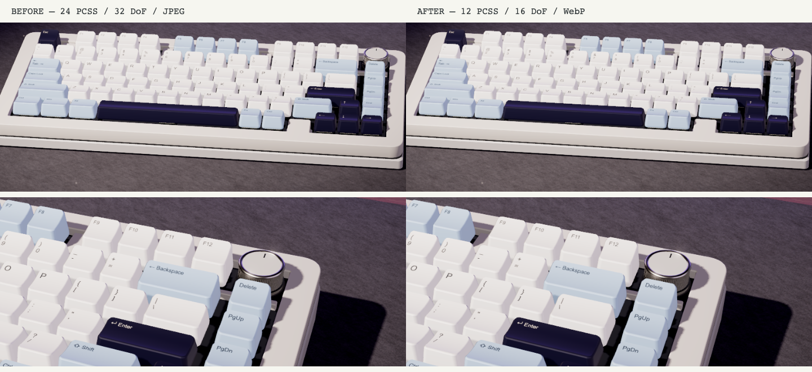

# Performance hunt

Baseline: master 4017d76. Native ANGLE/Metal; 1440×900 CSS except the 3840×2160 framebuffer fill-rate proxy. GPU columns are median / p95 milliseconds, at least 300 queries per scope. High quality is pinned. CPU and frame pacing use queries off. The final two-DPR validation remeasures main/frame and adds combined resolve/offscreen scopes; the full first scan is retained in JSON under initialScopeCollection.

## GPU scopes

| Scope | DPR 1.5 before | DPR 1.5 after | DPR 2 before | DPR 2 after | 4K before | 4K after |
|---|---:|---:|---:|---:|---:|---:|
| frame | 15.56 / 17.81 | 13.98 / 16.50 | 21.83 / 22.96 | 16.41 / 18.46 | 47.01 / 50.03 | 85.27 / 106.24 |
| mainScene | 7.96 / 9.71 | 7.95 / 9.45 | 10.23 / 10.99 | 8.54 / 9.94 | 15.97 / 56.93 | 158.42 / 325.38 |
| shadowMap | — | 0.25 / 0.49 | — | 0.32 / 0.43 | — | 30.05 / 35.81 |
| environment.capture | — | 0.31 / 1.16 | — | 0.15 / 0.81 | — | 1.34 / 3.42 |
| scene.resolve | 0.10 / 0.13 | 0.39 / 0.77 | 0.16 / 0.22 | 0.16 / 0.57 | 0.23 / 0.37 | 0.79 / 3.66 |
| depthOfField | 1.65 / 1.69 | 1.65 / 2.37 | 2.79 / 2.88 | 2.09 / 2.83 | 4.34 / 4.37 | 2.72 / 7.08 |
| bloom.threshold | 0.07 / 0.11 | 0.07 / 0.07 | 0.10 / 0.17 | 0.10 / 0.48 | 0.14 / 0.25 | 0.80 / 3.41 |
| bloom.mip0.x | 0.07 / 0.07 | 0.07 / 0.39 | 0.09 / 0.09 | 0.09 / 0.46 | 0.11 / 0.12 | 0.72 / 2.78 |
| bloom.mip0.y | 0.05 / 0.06 | 0.09 / 0.28 | 0.06 / 0.07 | 0.06 / 0.43 | 0.07 / 0.08 | 0.58 / 2.02 |
| bloom.mip1.x | 0.07 / 0.08 | 0.08 / 0.30 | 0.07 / 0.08 | 0.07 / 0.43 | 0.08 / 0.08 | 0.57 / 1.91 |
| bloom.mip1.y | 0.05 / 0.06 | 0.05 / 0.24 | 0.05 / 0.06 | 0.05 / 0.06 | 0.06 / 0.06 | 0.65 / 2.91 |
| bloom.mip2.x | 0.06 / 0.07 | 0.06 / 0.07 | 0.08 / 0.09 | 0.08 / 0.08 | 0.09 / 0.10 | 0.33 / 1.94 |
| bloom.mip2.y | 0.05 / 0.05 | 0.05 / 0.06 | 0.06 / 0.06 | 0.06 / 0.06 | 0.06 / 0.06 | 0.08 / 0.52 |
| bloom.mip3.x | 0.07 / 0.07 | 0.07 / 0.07 | 0.07 / 0.08 | 0.07 / 0.08 | 0.07 / 0.08 | 0.08 / 0.51 |
| bloom.mip3.y | 0.05 / 0.06 | 0.05 / 0.05 | 0.05 / 0.06 | 0.05 / 0.40 | 0.05 / 0.06 | 0.07 / 0.50 |
| bloom.mip4.x | 0.05 / 0.06 | 0.05 / 0.06 | 0.07 / 0.07 | 0.42 / 1.55 | 0.08 / 0.09 | 0.09 / 0.57 |
| bloom.mip4.y | 0.05 / 0.05 | 0.05 / 0.05 | 0.05 / 0.06 | 0.50 / 1.60 | 0.06 / 0.06 | 0.07 / 0.54 |
| bloom.composite | 0.05 / 0.05 | 0.05 / 0.38 | 0.06 / 0.06 | 0.47 / 1.66 | 0.07 / 0.07 | 0.08 / 0.54 |
| bloom.blend | 0.10 / 0.11 | 0.10 / 0.72 | 0.15 / 0.16 | 0.47 / 2.45 | 0.22 / 0.23 | 0.35 / 1.44 |
| dustAfterDoF | 0.04 / 0.04 | 0.04 / 0.05 | 0.04 / 0.04 | 0.25 / 0.96 | 0.04 / 0.04 | 0.04 / 0.38 |
| gradingAndOutput | 0.30 / 0.30 | 0.30 / 0.30 | 0.51 / 0.52 | 0.78 / 1.78 | 0.80 / 0.82 | 1.08 / 2.34 |
| scene.withResolve | — | 7.99 / 9.77 | — | 8.48 / 10.15 | — | — |
| frame.offscreen | — | 14.63 / 17.80 | — | 16.47 / 18.66 | — | — |

The largest tested main-scene feature cost was the original PCSS kernel. The isolated unchanged main pass was 6.82 / 13.39, hardware PCF 5.44 / 5.79, and the unchanged ending anchor 6.80 / 7.82. These are diagnostic perturbations, not additive pass costs.

| Isolated perturbation | Main scene median / p95 ms |
|---|---:|
| default | 6.82 / 13.39 |
| hardwarePCF | 5.44 / 5.79 |
| receiverShadowsOff | 5.46 / 5.91 |
| largeReceiverShadowsOff | 6.41 / 7.33 |
| areaLightsOff | 5.85 / 6.50 |
| capCoatAndSheenOff | 6.40 / 7.14 |
| woodCoatAndNormalsOff | 6.57 / 12.54 |
| wallShaderOff | 6.75 / 7.69 |
| defaultEnd | 6.80 / 7.82 |

## Interpreting the frame gap

The original profiler omitted the MSAA color/depth resolve performed by setRenderTarget between scene rendering and postprocessing. The scene.withResolve scope measures the actual scene draw plus clear and resolve together; subtracting isolated medians is only a diagnostic estimate. Repeated blits without new draws are driver-eliminated (zero timer result), so they are not presented as a valid standalone resolve measurement. Shadow maps, environment and monitor captures are counted separately; zero idle updates cannot explain a persistent idle gap. The report includes forced shadow/probe update costs, which must not be charged to idle. A final frame.offscreen diagnostic runs the same pass chain into the HDR composer target instead of the canvas; its final attachment format differs, so this is a presentation/scheduling diagnostic, not an exact presentation-only subtraction.

Metal elapsed queries for multiple scopes in a command buffer are cumulative. Diagnostic pass measurements prime the actual pipeline, then submit the selected scope with its real inputs in isolation. Whole-frame counters also include driver scheduling and query overhead. During this run other long-lived test browsers and GPU applications were active on the shared host. The 4K isolated main query even exceeded the whole-frame counter; its absolute result is confounded and does not establish a speedup or weak-device frame rate. Isolated medians cannot be added to reconstruct the whole-frame counter; the remaining difference is unresolved scheduling/bandwidth interaction, not evidence of an unobserved recurring scene render. DoF includes CoC and gather in one shader.

## CPU, resources and loading

| DPR/scenario | CPU ms/frame before → after | Draws before → after | Programs before → after | Estimated texture/FBO MiB before → after | FPS after |
|---|---:|---:|---:|---:|---:|
| 1.5 | 1.26 → 1.35 | 241 → 241 | 217 → 215 | 499.21 → 499.21 | 60.07 |
| 2 | 1.22 → 1.41 | 241 → 241 | 217 → 215 | 670.79 → 670.79 | 60.07 |
| 4K | 1.20 → 1.68 | 241 → 241 | 217 → 215 | 906.11 → 906.11 | 33.79 |

The final combined draw/resolve medians are 7.99 ms versus main-only 7.95 ms; 8.48 ms versus main-only 8.54 ms. The difference is within timing noise; resolve does not explain the multi-millisecond gap. Offscreen frame medians are 14.63 / 16.47 ms, close to onscreen, so canvas presentation is not established as the cause either. The remaining driver elapsed-time gap is unresolved; no recurring shadow/probe/reflection work was observed.

Alternating the original 24-point and optimized constant 12-point kernels with every other asset/effect held identical:

| Kernel run | Main median / p95 ms | Frame counter median / p95 ms | CPU submission mean during frame query ms |
|---|---:|---:|---:|
| original-24 | 8.75 / 10.42 | 16.23 / 22.50 | 1.23 |
| constant-12 | 6.39 / 8.83 | 11.71 / 15.84 | 1.22 |
| original-24 | 8.47 / 9.98 | 16.74 / 19.53 | 1.06 |
| constant-12 | 6.54 / 8.54 | 12.35 / 14.99 | 1.06 |

The separate optimized microfeature probes have 0.77 ms anchor drift, exceeding the measured legend cutoff and wall early-return deltas. Individual savings for these exact-output fast paths are unresolved on this host; no numerical saving is claimed. Raw diagnostics are retained.

JS/CSS bundles (including lazy diagnostics): {"before":{"bytes":2021793,"gzip":632014},"after":{"bytes":2030713,"gzip":635103}}. Seven 2048² JPEGs total 28,437,283 bytes; WebP derivatives total 11,500,056 bytes (59.6% smaller). Decoded texture dimensions/VRAM are unchanged. The wall's maps are procedural 512² textures. Memory figures estimate identified resources, not driver VRAM.

Controlled cold loads use 100ms RTT, 1.5MiB/s, cache disabled:

| Build | Ready/interactive CTA ms | Programs | Sum of image-decode medians ms |
|---|---:|---:|---:|
| before | 21381.60 | 199 | 194.50 |
| after | 11444.00 | 215 | 526.80 |

Preparation timings, named callback measurements, idle capture/upload counts, CPU profile/trace summaries, decode/compile timings and bundle details are preserved in perf-hunt.json. Full traces are generated under screenshots/ (ignored). A 4K framebuffer is an honest fill-rate stress proxy, not a claim about a specific weak GPU.

## Kept changes and checks

- Constant rotated PCSS disk: high 12 samples, medium 8, low hardware PCF. Live softness is a uniform; cache signatures distinguish kernels. Large black wall fragments and transparent legend texels exit before lighting.
- Depth-aware DoF: high 16 taps, medium 8, low disabled. Bloom retains its original five mips because it is cheap. Keycap/wood physical shading and the lighting rig remain tuned.
- Auto selects once after 2.5s of assembled rendering: under 30fps low, under 50 medium, otherwise high. URL override and Rendering → Quality support manual changes. DPR has independent hysteresis and ignores loading/intro stalls.
- WebP derivatives retain source resolution, attribution and reproducible downloads.
- Both monitor panel materials exist during startup preparation, including the off state needed on stage 1. Stage permutations receive tiny warm draws and an asynchronous completion fence.

No speculative area-light removal, physical-material simplification, wall lighting replacement or bloom downsampling is shipped. The inherited report's hard-coded benchmark claims were removed in favor of measured artifacts. The cold-start quality-test timeout now matches the profiler's 120-second readiness allowance. The off-panel explicitly retains its original zero emissive intensity. The full stage test recorded a maximum 16.8 ms frame, zero frames above 34 ms, and one environment capture per transition (the inherited failure was 83.2 ms and three slow frames on stage 1).

| View | Mean channel error /255 | p99 /255 | Channels changing >8 (%) |
|---|---:|---:|---:|
| hero-glacial-blue | 0.29 | 4 | 0.18 |
| hero-cool-black | 0.29 | 4 | 0.16 |
| hero-pink | 0.29 | 4 | 0.18 |
| closeup | 0.21 | 2 | 0.09 |
| terminal | 0.00 | 0 | 0.00 |
| stage-7 | 0.29 | 4 | 0.18 |

Limits remain mean ≤0.65, p99 ≤5, and ≤0.6% channels changing by >8. All 87 screenshot check groups and the performance runner passed.

Production is verified after push against the deployed commit SHA and browser errors. That separate live result is recorded in the task's final response.
